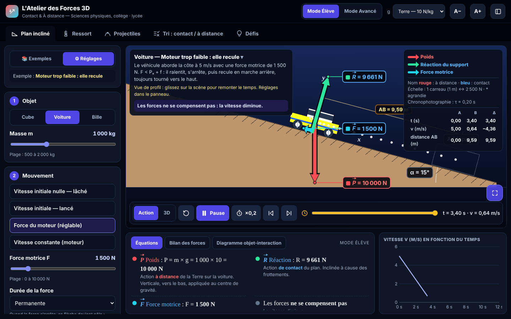
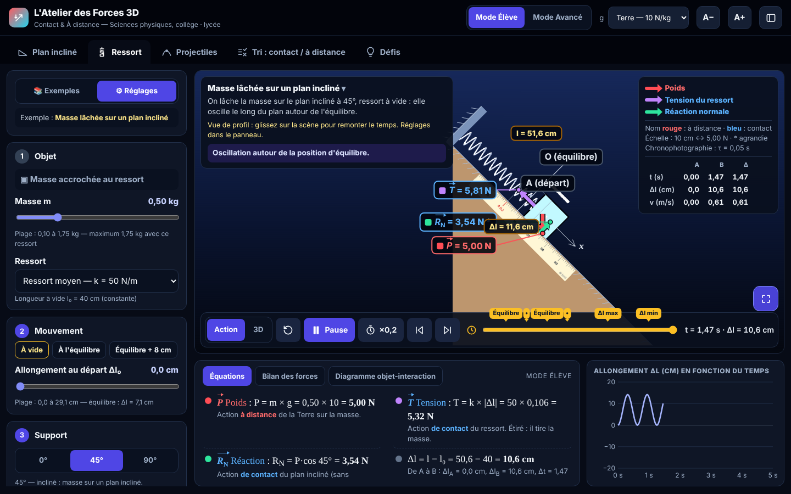
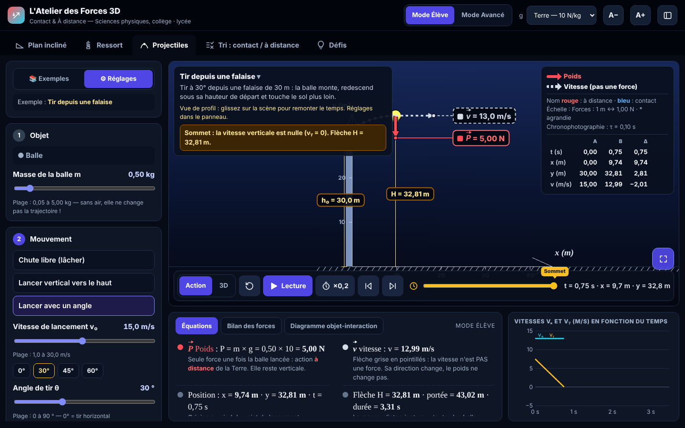

# L'Atelier des Forces 3D — Contact & À distance

**Version 1.1** (en cours)

Laboratoire virtuel interactif de sciences physiques (collège · lycée) pour comprendre les forces : **actions de contact** (flèches bleues) et **actions à distance** (flèches rouges).

👉 **Essayer en ligne : [oumarmaiil-oss.github.io/atelierforces](https://oumarmaiil-oss.github.io/atelierforces/)**

## Contenu

| Onglet | Ce qu'on y fait |
|---|---|
| **Plan incliné** | Cube, voiture ou bille ; lâché, lancé, poussé par la main ou tiré par le moteur, vitesse constante en montée ou en descente ; marche arrière quand le moteur est trop faible. |
| **Ressort** | Horizontal (0°), incliné (45°) ou vertical (90°) ; ressorts souple, moyen, raide ; position d'équilibre et règle graduée en Δl. |
| **Projectiles** | Chute libre, lancer vertical, lancer avec un angle, depuis le sol ou une hauteur jusqu'à 50 m ; avec ou sans frottement de l'air (trajectoire idéale en pointillés). |
| **Tri** | 14 situations « contact ou à distance ? », avec correction guidée. |
| **Défis** | « Je prédis, puis j'observe », reliés à la simulation. |

## Le panneau de gauche

- **📚 Exemples** : les 32 situations toutes prêtes, rangées par notion du programme, avec une ligne « ce que ça illustre ». Un clic charge l'exemple ; un badge « modifié » apparaît dès qu'on change un réglage (re-cliquer l'exemple ou ↺ pour revenir).
- **⚙ Réglages** : quatre étapes, toujours dans le même ordre — **1. Objet · 2. Mouvement · 3. Support · 4. Frottements** (aucun, faible, moyen, fort ; μ chiffré au niveau 3), chacune avec une aide d'une ligne. L'encadré « Au départ » résume l'expérience en une phrase.

## Niveaux d'affichage

**1 · Forces** (flèches et noms, pour identifier les forces) · **2 · Valeurs** (valeurs en newtons et équations) · **3 · Analyse** (composantes du poids, réaction normale et frottement, μ, deuxième loi de Newton). Le bouton **Une par une** de la légende (touche S) montre les forces l'une après l'autre ; un clic sur une force de la légende l'isole.

## Lecture des forces

Chaque force a sa propre couleur de flèche, à l'échelle avec une longueur minimale. Son nom est écrit en **rouge** pour une action à distance et en **bleu** pour une action de contact. Les vitesses sont en pointillés gris (ce ne sont pas des forces). Axes x et y, centre de gravité G, bilan des forces, diagramme objet-interaction, équations détaillées au niveau 3. Lignes de cote épaisses à flèches : AB, hauteur h et Δx sur la pente (triangle rectangle), l₀, Δl et l pour le ressort, h₀, H et portée pour les projectiles.

## Outils

Frise du temps avec repères cliquables aux moments clés, pas à pas avant / arrière, ralenti ×0,2, pauses automatiques, chronophotographie, fiche A → B, cotes, graphiques en direct, plein écran de la scène, taille des textes réglable, raccourcis clavier (Espace, ← →, R, T, S, 1 2 3, D, L, P, F ; liste avec la touche ?), bouton « Signaler une erreur » (WhatsApp, message prérempli). Les derniers réglages sont mémorisés dans le navigateur.

## Utilisation

Un seul fichier : ouvrez `index.html` dans un navigateur. Three.js 0.187 (rendu 3D) est intégré au fichier : l'atelier fonctionne **sans connexion**, et le fichier (~750 Ko) peut se partager par WhatsApp ou clé USB.

Ordinateur, vidéoprojecteur, tablette et téléphone (portrait ou paysage) : sur petit écran, la scène reste visible en haut et le panneau, les équations et le graphique s'ouvrent dans un volet à onglets.

## Pour les développeurs

- `node outils/integrer-three.mjs` : régénère le sous-ensemble de Three.js intégré à `index.html` (après `npm i --no-save three@0.187.0 esbuild`).
- `node tests/verifier.mjs` : vérifie l'atelier sur 7 tailles d'écran (erreurs, hors ligne, débordements, 32 exemples) — après `npm i --no-save playwright-core`.

## Licence

[MIT](LICENSE) — © 2026 Dr Oumar Sow. Réutilisation et contributions bienvenues.
